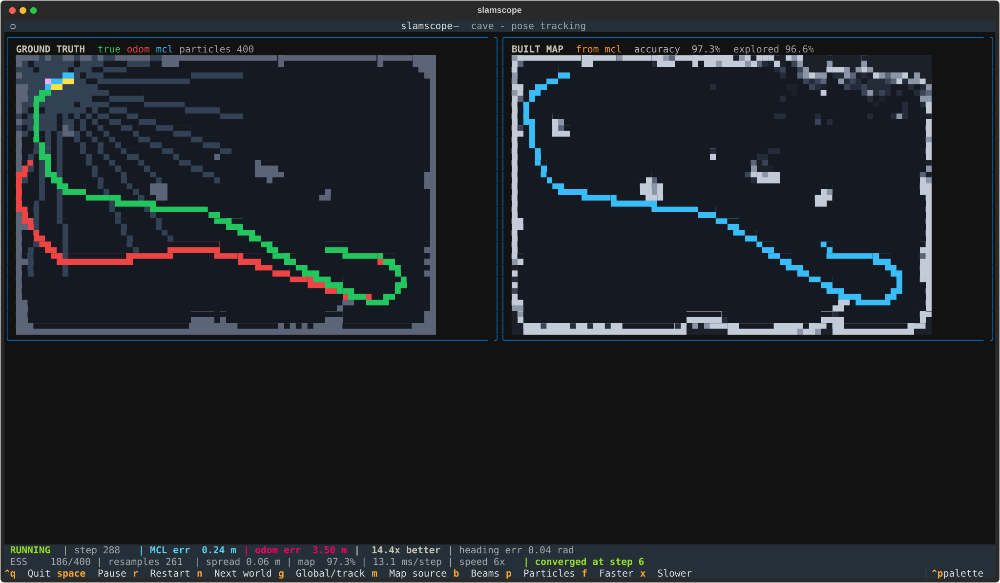

# slamscope

Particle-filter localization and occupancy mapping, in your terminal.

A robot drives through an unknown world, builds a map from noisy lidar, and
works out where it is with Monte Carlo Localization — while dead reckoning
drifts away beside it.



Left: ground truth. Green is the true path, red is dead reckoning, violet is
the particle cloud. Right: the map the robot has built for itself, from its own
estimated pose.

## What it actually implements

- **Raycasting** — Amanatides-Woo DDA grid traversal, exact to floating point
- **Motion model** — the six-parameter velocity model from Thrun, Burgard & Fox,
  *Probabilistic Robotics* (Ch. 5)
- **Sensor model** — likelihood field (Ch. 6.4) over a Euclidean distance
  transform, so a scan costs one lookup per beam instead of a raycast per beam
  per particle
- **MCL** — low-variance systematic resampling, ESS-triggered resampling,
  roughening, AMCL-style random particle injection for recovery
- **Mapping** — log-odds occupancy grid with an inverse sensor model

## Install

```bash
git clone https://github.com/kris072008/slamscope
cd slamscope
pip install -e .
```

## Usage

```bash
slamscope                      # office, pose tracking
slamscope cave                 # a different world
slamscope --global             # start with no idea where the robot is
slamscope --map-from odom      # build the map from dead reckoning instead
slamscope --bench 400 --trials 8
slamscope --list
```

| Key | Action |
| --- | --- |
| `Space` | Pause |
| `R` | Restart |
| `N` | Next world |
| `G` | Toggle global localization / pose tracking |
| `M` | Cycle map source: mcl → odom → truth |
| `B` / `P` | Toggle beams / particles |
| `F` / `X` | Faster / slower |
| `Ctrl+Q` | Quit |

## Results

Median over 8 seeds, 300 steps, 500 particles, pose tracking:

| World | MCL error | Dead reckoning | Map accuracy |
| --- | --- | --- | --- |
| office | 0.11 m | 1.59 m | 93.2% |
| cave | 0.19 m | 3.39 m | 96.3% |
| pillars | 0.13 m | 2.93 m | 95.5% |

Pose tracking converges in 7–8 runs out of 8 and beats dead reckoning in 8 of 8,
roughly 15–20x better.

**Global localization is harder and does not always work.** From a uniform prior
over the whole map it converges in about half of runs within 400 steps. The
posterior is genuinely multi-modal early on, and in a world with repeated
structure it can settle on the wrong hypothesis. That is a real property of MCL,
not a bug, and the tool shows it rather than hiding it — press `G` and watch.

Mapping quality tracks localization quality exactly, which is the whole point:

| Map built from | Accuracy |
| --- | --- |
| true pose | 99.5% |
| MCL estimate | 97.0% |
| dead reckoning | 85.2% |

Press `M` to switch between them and watch the map smear as odometry drifts.

## Three bugs worth writing down

**The off-map attractor.** `LikelihoodField.at()` returned distance 0.0 for
coordinates outside the map. Zero distance means "an obstacle is exactly here" —
the *highest possible* score. Everywhere outside the world looked like a perfect
sensor match, the entire particle cloud escaped, and the filter settled on a
pose 18 m outside a 15 m world. Off-map has to be penalised, not rewarded.
Fixing it took global localization from 0 of 6 runs to 6 of 6.

**No-return beams punching holes in walls.** Max-range readings were clearing
free space along their whole length. But a no-return reading is ambiguous: open
space, an absorbing surface, or a glancing angle all produce it. In the maze this
caused **625 of 630 mapping errors** — real walls confidently marked as empty.
Now such beams contribute nothing unless you ask for it.

**An overconfident sensor model.** Beams are treated as independent, but
adjacent rays see the same wall, so multiplying 24 of them produces a posterior
far sharper than the real information content. Untempered, one particle took
essentially all the weight on the first update — measured effective sample size
was **3 out of 2000** — and the filter died before it could converge. Dividing
the summed log-likelihood by a temperature restores a usable spread.

## Testing

```bash
pip install -e ".[dev]"
pytest
```

60 tests. The ones that matter check properties, not output: raycasts match
analytic distances including thin walls at grazing angles, the distance
transform matches brute force exactly at every cell, the zero-noise motion model
reproduces exact arc geometry, the low-variance resampler gives a particle with
half the weight about half the copies, heading averaging returns 180 degrees for
+179 and -179, and MCL beats dead reckoning. The two bugs above have named
regression tests.

## References

- Thrun, S., Burgard, W. and Fox, D. (2005). *Probabilistic Robotics.* MIT Press.
- Amanatides, J. and Woo, A. (1987). *A Fast Voxel Traversal Algorithm for Ray
  Tracing.* Eurographics.

## License

MIT
